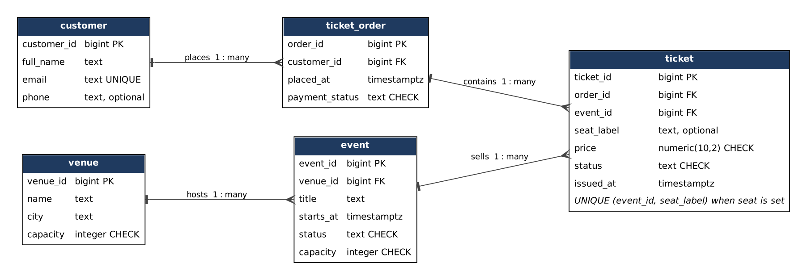
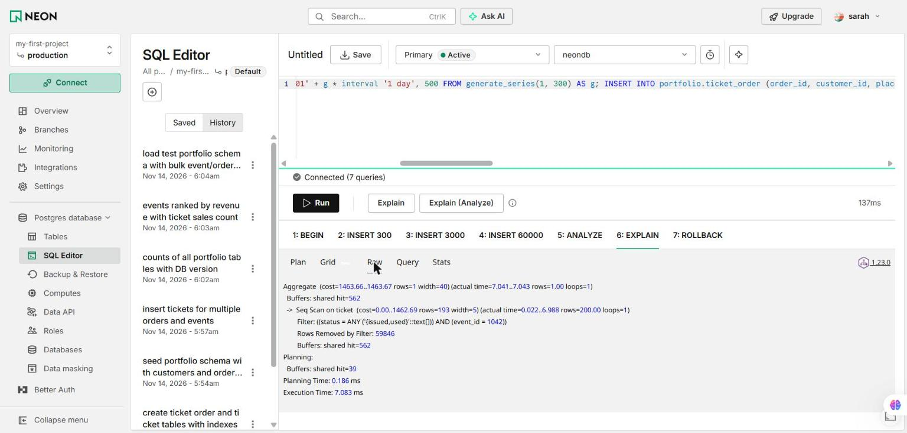
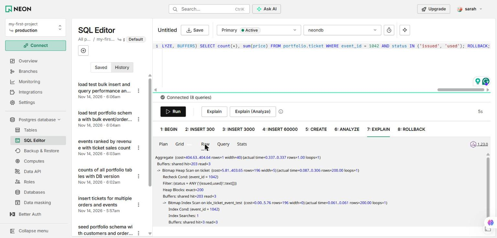
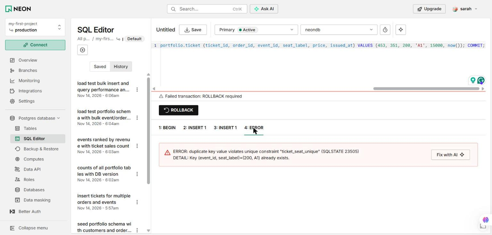
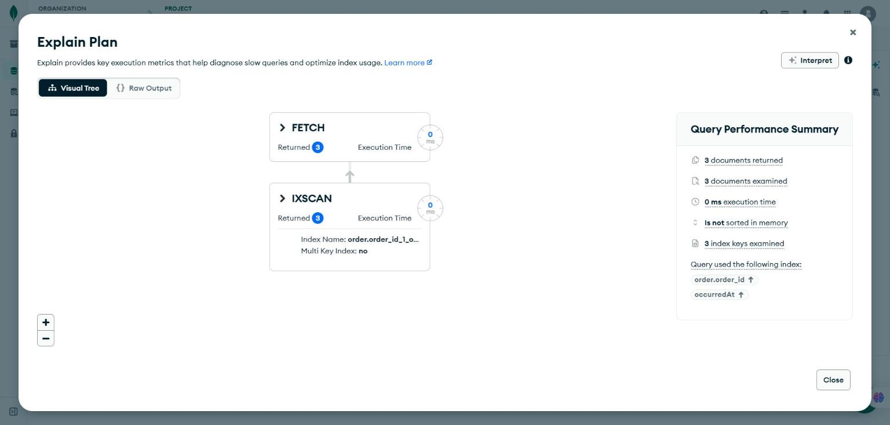

# MIT 8103 Advanced Database Systems: Portfolio Summary

**Ndianekwu Chibuzor Sarah · Student ID 301893177**

Repository: https://github.com/sarahannie/ndianekwu_Chibuzor_301893177

## Selected organisation

Event Ticketing Platform, a fictional Nigerian company selling tickets for concerts, shows and workshops at hired venues. Customers buy tickets; event, gate and finance staff schedule events, scan tickets and report revenue. The database stores customers, venues, events, orders, tickets and a log of ticket activity. It must schedule events, issue tickets, find events by venue and date, report revenue per event, and never sell a seat or the last place twice.

## Portfolio 1: Database Design and Modelling

Five PostgreSQL tables in third normal form: customer, venue, event, ticket_order, ticket. Rules are enforced with primary and foreign keys, NOT NULL, CHECK constraints on capacity, price and status values, a unique email, and a partial unique index that allows one ticket per numbered seat per event while leaving general admission tickets unrestricted. Sample data: 12 customers, 5 venues, 8 events, 24 orders, 46 tickets. All 15 invalid statements in the constraint tests were rejected and row counts were unchanged.

Figure 1. Entity-relationship diagram.

## Portfolio 2: Query Processing and Optimisation

Four queries cover the stated operations: events by venue and date, revenue per event, a customer's order history (five-table join), and events at least half sold. Each was run with EXPLAIN (ANALYZE, BUFFERS). For the index test, 60,000 tickets were added and the "sales for one event" lookup was measured three times each way.

| | Before index | After index on ticket(event_id) |
| --- | --- | --- |
| Plan | Seq Scan | Bitmap Index Scan + Bitmap Heap Scan |
| Pages read | 562 | 203 |
| Median time | 3.454 ms | 0.128 ms |

The result was the same (200 tickets). A query matching 58,000 rows still used the sequential scan, so the index only pays off for selective lookups. It added 416 kB and extra work on every insert.

## Portfolio 3: Transactions and Concurrency

An order with two seats committed as one unit. An order containing an already sold seat failed with error 23505 and ROLLBACK removed the whole order; a SAVEPOINT version kept the order and replaced only the failed seat. Two sessions then tried to buy the last place of an event with capacity 3:

| Method | Final tickets | Outcome |
| --- | --- | --- |
| READ COMMITTED, count then insert | 4 | oversold |
| SELECT ... FOR UPDATE on the event row | 3 | second buyer waited 1.99 s, then was refused |
| SERIALIZABLE | 3 | one transaction cancelled with 40001 |

## Portfolio 4: NoSQL and Advanced Data Models

A MongoDB collection, ticket_events, logs four kinds of activity (order placed, ticket issued, ticket scanned, order refunded). Customer, event and venue details are embedded so one read shows a full entry, and a details sub-document differs by type. A JSON Schema validator fixes the common fields. It was built and tested on a MongoDB Atlas free cluster: six documents inserted, a text date rejected by the validator, and the order-timeline query moved from COLLSCAN (6 documents examined) to IXSCAN (3 examined) after a compound index on order.order_id and occurredAt. PostgreSQL stays the owner of current data and of the rules that need constraints.

## Portfolio 5: Distributed and Cloud Database Exercise

Discussion option. The proposal is a three-member MongoDB replica set across three availability zones, majority write concern, primary reads where committed data is required, and a hashed shard key on order.order_id if the log outgrows one replica set. Replication gives availability but not backup, and PostgreSQL needs its own high-availability setup. Nothing was deployed.

## Evidence

Each portfolio folder holds the scripts, a README, the unedited psql output (PostgreSQL 16) and screenshots from Neon (PostgreSQL 18.7) and MongoDB Atlas. Four of them:

Figure 2. Top: the same lookup before and after the index (Neon). Bottom left: an order with an already sold seat fails and must be rolled back (Neon). Bottom right: MongoDB uses the compound index (Atlas).

## Individual reflection

I chose an event ticketing platform because it is close to a product I am already building, ModelClic. ModelClic lets event organisers hire ushers, personal assistants and other support staff, for example 20 to 30 people to help serve food at an event. A ticketing platform is where organisers first register their events, so it is the natural place to later offer them staff from ModelClic. Working on this case study let me practise on the kind of data I will handle in my own product: events, venues, customers and orders.

In the first concurrency test both buyers were given the last ticket, so the event was oversold. What I took from it is that the system must show that someone is already on that ticket before a second buyer is told it is free. The row lock does this: the first buyer holds the ticket and the second waits. If the first buyer does not complete the purchase, the ticket opens again for the next person; if it is sold, the second buyer sees that immediately. In the test the second buyer waited 1.99 seconds and was then told the event was full. I prefer the lock to the SERIALIZABLE approach, where one buyer's purchase is cancelled afterwards. Cancelling is a weak customer experience: if I have already told my boss the ticket is available and learn a minute later that it is gone, that damages trust in the business.

The index test worked like looking for my own name in a phone book. Without an index the pages are in no order, so every page has to be read: PostgreSQL read all 60,046 tickets to find 200 and threw away 59,846, which took 7.083 ms on Neon. With the index there is an ordered list that points to the right pages, so it went straight to the 200 rows in 0.371 ms. That is why I will rely on indexes for the lookups my product runs most often. The test also showed two limits. An index is not always used: when a query wanted almost all the rows, PostgreSQL ignored it because reading everything was cheaper. And an index is not free: it takes storage, and every new ticket must also be added to it.

The hardest part came first: choosing the project. The brief listed several case studies, but none of them resonated with me, so I had to think about which real scenario would still be useful to me after the course. That led me to event ticketing, because of ModelClic. The second challenge was the database itself. I am used to MongoDB, so Portfolio 4 was familiar, but this was my first time using PostgreSQL or any SQL language. The course material explains the ideas, but doing it for real is different, and I also had to find a tool I could run PostgreSQL on easily; I settled on Neon because it works in the browser. Doing these things for the first time, and comparing how the relational and document databases behave, was where most of my effort went.

## AI-use declaration

I used Claude (Anthropic) to help with the database model description and explanation. I am responsible for checking my narration, my individual influence and the rest of the submitted work.

## References

- PostgreSQL Global Development Group (2026). *PostgreSQL 16 documentation*: Constraints; Using EXPLAIN; Indexes; Transaction Isolation; Explicit Locking. https://www.postgresql.org/docs/16/
- MongoDB, Inc. (2026). *MongoDB Manual*: Data Modeling; Schema Validation; Replication; Sharding. https://www.mongodb.com/docs/manual/
- Graphviz. https://graphviz.org/ and Mermaid ER diagrams. https://mermaid.js.org/syntax/entityRelationshipDiagram.html
