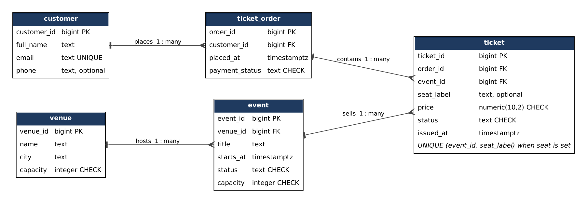
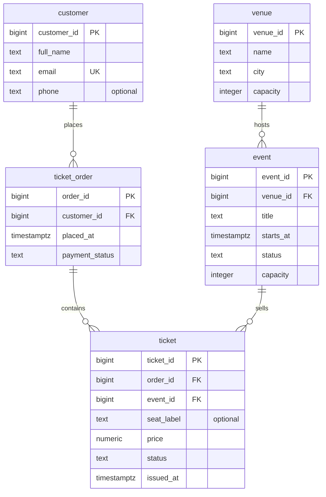

# Event Ticketing Platform: ER diagram

The same model in Mermaid (GitHub renders it):

Reading the lines: `||` is exactly one, `o{` is zero or many. A customer can have no orders yet; an order always belongs to exactly one customer.

The PNG was drawn with Graphviz from the same table list.
